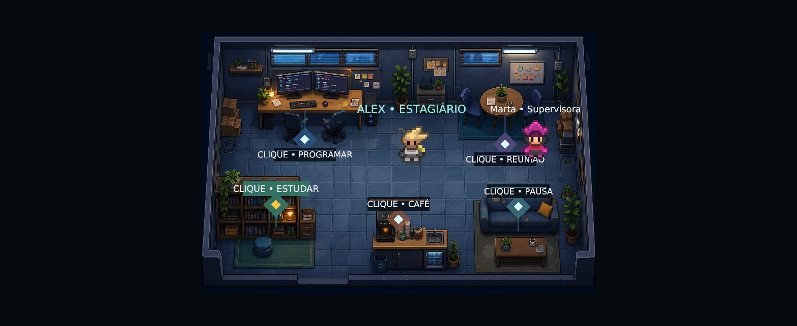

# Assets de personagens — ELV Games

Atualizado em 07/09/2026.

O jogo utiliza **Free TopDown RPG Retro Sprites! / Free Character Sprites —
Fantasy Dreamland**, da **ELV Games**. Os arquivos estão incluídos no projeto;
não é necessário baixar outro pacote para abrir as cenas.

- Página oficial: https://elvgames.itch.io/free-retro-game-world-sprites
- Pasta: `Assets/Art/ELVCharacters/`.
- Proveniência, hash do download e mapeamento: [CREDITS.md](../Assets/Art/ELVCharacters/CREDITS.md).
- Licença original: [License.txt](../Assets/Art/ELVCharacters/License.txt).

## Conteúdo utilizado

São seis personagens, `Char_001` a `Char_006`. Cada personagem possui um PNG
de caminhada e outro com sufixo `_Idle`, totalizando 12 folhas originais.
Alex utiliza `Char_003`; os cinco demais visuais são distribuídos entre os
colegas conforme a tabela de créditos.

Os arquivos vieram da pasta `16x16` do download, mas cada folha mede **96 × 96
pixels**, com grade 4 × 4 e quadros de **24 × 24 pixels**. As linhas representam,
de cima para baixo, baixo, esquerda, direita e cima. Cada direção tem quatro
quadros. Os PNGs foram preservados sem edição.

O pacote é usado apenas nos personagens. Os quatro fundos de escritório ficam
em `Assets/Art/GeneratedOffices/`; a interface tem arte própria em
`Assets/Art/UI/Pixel/`. Móveis desenhados nos fundos não são tiles deste pacote.

## Importação e animação

- `Assets/Editor/ElvCharacterImporter.cs`: recorte automático em múltiplos
  sprites, filtro Point, sem compressão nem mipmaps, 12 pixels por unidade.
- `Assets/Scripts/Runtime/CharacterWalkAnimator.cs`: caminhada em quatro
  direções, passos sincronizados à distância, animação parado e sombra de contato.
- O pivô de caminhada compensa um pixel na vertical para alinhar os pés com
  a animação parado. Movimento reduzido mantém a pose parada estática.
- `Assets/Editor/OfficeMvpSceneBuilder.cs`: atribui as folhas de caminhada,
  animação parado e sprite inicial ao construir as cenas.

Os personagens estão em `OfficeInternMVP`, `OfficeDeveloperMVP`,
`OfficeLeadershipMVP`, `OfficeCtoMVP` e `OwnerFinale`. `MainMenu` exibe os créditos
da ELV Games. A integração não altera a progressão, as estações ou os saves.

## Manutenção e verificação

Ao alterar um personagem, mantenha o par de folhas correspondente e atualize
tanto a cena quanto o mapeamento do gerador. Não edite os GUIDs dos arquivos
`.meta` manualmente: as referências serializadas dependem deles.

Os testes em `Assets/Tests/EditMode/CharacterAssetTests.cs` verificam os 16
recortes de cada folha e os sprites e pares de animação usados pelos personagens
nas cenas habilitadas para build. Os testes de movimento ficam em
`Assets/Tests/PlayMode/OfficeMovementTests.cs`.

Referência visual atual:

Preserve a licença original e a identificação da ELV Games ao manter os assets
no projeto. Os arquivos não devem ser apresentados como arte autoral do estúdio.
